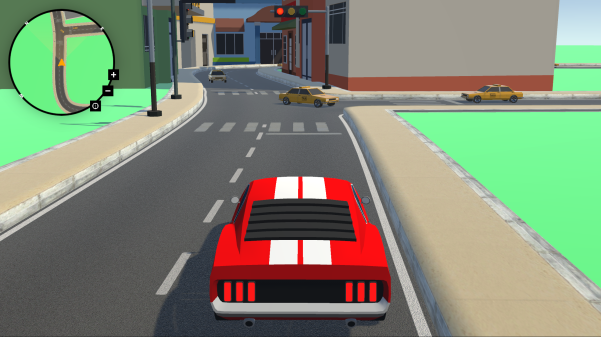

#### Thesis Project

# City Rush Hour: Promoting Traffic Awareness through Nagel-Schreckenberg and A\* Algorithms in a PC Traffic Simulator Game

**This repository serves as a code-only portfolio showcase.** It contains the custom C# architecture, systems, and algorithms we engineered. The heavy binary assets (textures, 3D models, audio) have been omitted to keep the repository lightweight and focused purely on code quality.\*\*

In-game picture

---

## Project Overview & Abstract

- The project aims to know the following - The traffic sitation in Bacolod City - To know whether the algorithms implemented by the researchers can address the identified problems in traffic simulations and route suggestions - To know the level of ser acceptance in terms of playability, effectiveness, and
  accuracy
- The researchers developed a traffic simulator game that models various traffic scenarios, including traffic flow, congestion, accidents, roadwork, and emergency response. It also incorporates traffic laws and regulations specific to the city, aiming to improve road awareness and promote safe driving practices. Violating said rules will result in penalties, emphasizing the importance of adhering to traffic laws in real-life scenarios. The game utilizes technologies such as Geographic Information Systems (GIS) and implements pathfinding algorithms such as the A\* Algorithm and the Nagel-Schreckenberg model to simulate realistic traffic scenarios.

## Technical Contributions

- **GIS Integration & Map Generation:** Engineered a pipeline to parse and integrate Geographic Information Systems (GIS) data into Unity, translating real-world city geometry and road layouts into accurate, playable in-game environments.
- **Microscopic Traffic Flow Modeling:** Implemented the mathematical _Nagel-Schreckenberg cellular automaton model_ to simulate realistic highway and street traffic dynamics, accurately reproducing real-world phenomena like emergent traffic jams, congestion waves, and acceleration/deceleration behaviors.
- **Intelligent Agent Navigation (A\* Pathfinding):** Developed an optimized A\* Pathfinding system allowing dynamic vehicle routing through complex city grids, enabling AI drivers to navigate around active roadworks, accidents, and sudden lane closures in real time.
- **Dynamic Event & Incident Architecture:** Designed an event-driven system to procedurally inject dynamic road scenarios, such as vehicle accidents, emergency vehicle prioritizing (right-of-way routing), and road maintenance blockades, and evaluated how the traffic network adapted.
- **State Machine Traffic Law & Rule Enforcement:** Built a modular validation system that monitors vehicle-to-environment triggers (speed limits, traffic signals, right-of-way zones). It accurately tracks traffic law infractions and applies algorithmic scoring/penalties to the player or simulated entities.

## Tech Stack

- **Engine:** Unity
- **Language:** C#
